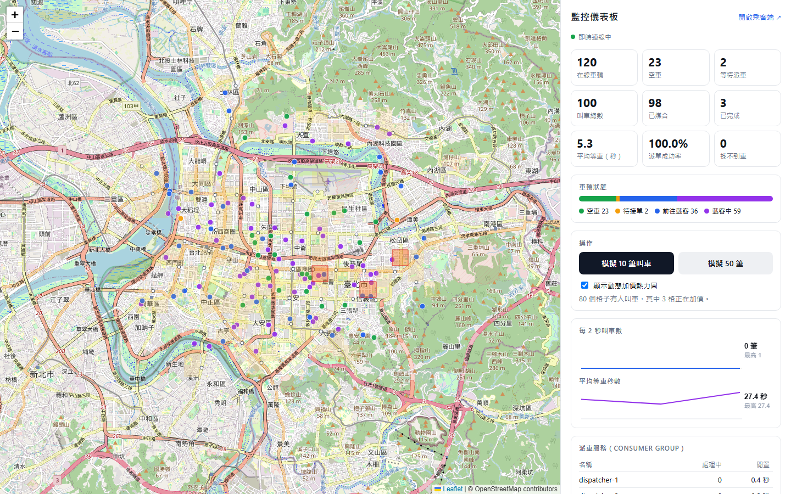

# 即時派車模擬系統

仿叫車平台的即時派車系統：台北市地圖上有 50～200 台模擬車輛移動，乘客叫車後系統找出最近的空車並派單，
而且保證**同一台車不會同時被派給兩位乘客**。四個程式彼此不直接溝通，全部透過 Redis 交換資料。



| 角色 | 介面 | 程式 |
| --- | --- | --- |
| 司機模擬器 | cmd 文字模式，可輸入指令 | `simulator.py` |
| 乘客端 | 瀏覽器（Leaflet 地圖） | `app.py` + `static/rider.html` |
| 派車服務 | 背景程式，可同時開多個 | `dispatcher.py` |
| 監控儀表板 | 瀏覽器 | `app.py` + `static/dashboard.html` |

## 快速開始

需要 Python 3.11 以上與 Docker（或任何 Redis 7 以上的服務）。

```bash
docker compose up -d
```

```bash
python -m venv .venv
```

```bash
.venv\Scripts\pip install -r requirements.txt
```

Windows 可以直接執行 `start_all.bat`，它會開四個視窗（兩個 dispatcher、模擬器、後端）。手動啟動的話，各開一個 cmd 視窗：

```bash
.venv\Scripts\python dispatcher.py --name dispatcher-1
```

```bash
.venv\Scripts\python dispatcher.py --name dispatcher-2
```

```bash
.venv\Scripts\python simulator.py --cars 100 --speed 150
```

```bash
.venv\Scripts\python -m uvicorn app:app --port 8000
```

然後打開：

- 乘客端 <http://localhost:8000/>：在地圖點上車點與目的地，按「叫車」
- 監控儀表板 <http://localhost:8000/dashboard>

Redis 不在本機時，設定環境變數 `REDIS_URL`（例如 `redis://:密碼@主機:6379/0`）。

### 模擬器指令

在模擬器視窗直接輸入：

| 指令 | 作用 |
| --- | --- |
| `add 20` / `remove 20` | 增減車輛 |
| `kill car-003` | 讓這台車停止心跳，5 秒後被偵測為離線 |
| `rate 0` | 接單率改成 0（所有司機都拒單或不回應，用來展示逾時改派） |
| `speed 300` | 改車速 |
| `status` / `quit` | 顯示統計／全部下線並結束 |

## 壓力測試與正確性檢查

```bash
.venv\Scripts\python simulator.py --cars 200 --speed 1200
```

```bash
.venv\Scripts\python simulate_riders.py --n 1000 --duration 60
```

送完後會等所有行程結束，再自動執行 `verify.py` 的四項檢查，報告存到 `reports/stress_report.txt`。

實測結果（1000 筆叫車 / 60 秒、200 台車、2 個 dispatcher，Windows 11 + Docker Desktop）：

| 項目 | 結果 |
| --- | --- |
| 重播 4,326 筆事件，司機同時被派兩單的次數 | **0** |
| 司機 Hash、行程 Hash、空車 GEO 三者不一致的筆數 | **0** |
| 831 次派單中，派給「最近且尚未被搶走的空車」的次數 | **831** |
| 其中最近的車被另一個 dispatcher 搶走、自動換下一台 | 12 次 |
| 計數器（叫車、媒合、完成、失敗、派單、拒單、逾時）與實際資料 | 全部一致 |
| 叫車延遲 | 中位數 2.6 ms、P99 5.6 ms |
| 完成 / 找不到車 | 664 / 336 |

找不到車的 336 筆是供不應求造成的：每秒 16.7 筆叫車，200 台車即使全速也消化不完，5 公里內連續重試仍沒有空車就會回報失敗。這是預期行為，計數仍然一致。

Pipeline 的效果（`bench_pipeline.py`）：200 台車回報一輪位置，逐筆送 90.9 ms，Pipeline 7.0 ms，約 13 倍。

另外實測過兩個故障情境：

- **dispatcher 被強制關閉**：它取走但沒 ACK 的請求留在 Pending 清單，30 秒後由另一個 dispatcher 用 `XAUTOCLAIM` 接手。
  重現方式：多開一個 `python dispatcher.py --name dispatcher-slow --slow 60`，叫幾筆車後把它關掉。
- **模擬器被強制關閉**：所有車的心跳 key 在 5 秒內過期，dispatcher 收到過期通知後把車移出地圖；
  還沒載到客人的行程自動改派，載客中的行程標記為中止。之後再跑 `verify.py` 仍然全部通過。

## 設計重點

**兩個 GEO key。** `drivers:all` 放所有在線車輛（畫地圖用），`drivers:available` 只放空車（派車只查這個）。
車一被派單就從 `drivers:available` 移除，別人自然搜不到它。

**所有「先檢查、再修改」都寫成 Lua。** 例如 `dispatch.lua` 在同一個腳本裡確認司機是空車、把他移出空車清單、
改狀態、設定 10 秒的 `offer:{tid}`。兩個 dispatcher 同時搶同一台車，只有一個會成功。

**遇到的坑：派單後又被加回空車清單。** 模擬器每秒回報位置，如果直接 `GEOADD drivers:available`，
剛被派單的車下一秒又會回到空車清單而被派第二次。解法是 `update_position.lua`：狀態是 available 才寫入空車清單。

**過期通知不保證送達。** Keyspace Notification 走 Pub/Sub，dispatcher 剛好斷線就會漏接。
所以另外用 Sorted Set `trips:offered` 記錄每筆 offer 的期限，每秒補掃一次；`release.lua` 會確認 offer 真的已經不在才改派，
重複呼叫也沒有副作用。

**延遲重試用 Sorted Set。** 半徑內沒車時不是立刻重試，而是 `ZADD queue:delayed`（score = 2 秒後），
由 `promote.lua` 到期後搬回 Stream。搜尋半徑依序是 1 → 3 → 5 公里。

**動態加價。** 地圖切成約 500 公尺的格子，叫車時 `INCR surge:{格子}`（TTL 60 秒），
再用 `GEOSEARCH … BYBOX` 數格內空車；叫車數 ÷ 空車數超過 2 車資 ×1.5，超過 4 則 ×2.0。

## Redis Key 一覽

| Key | 型別 | 用途 |
| --- | --- | --- |
| `drivers:all` / `drivers:available` | GEO | 所有在線車輛／只放空車 |
| `driver:{id}` | Hash | `status, trip, lon, lat, rating, trips_done, earnings` |
| `driver:alive:{id}` | String，TTL 5 秒 | 心跳 |
| `seq:trip` | String | 行程流水號 |
| `trip:{tid}` | Hash | 上下車點、狀態、司機、各階段時間、距離、加價倍率、車資 |
| `trip:{tid}:tried` | Set | 已拒單或逾時的司機，不再重派 |
| `offer:{tid}` | String，TTL 10 秒 | 等待接單，值是司機 id |
| `stream:ride_requests` + group `dispatchers` | Stream | 叫車佇列 |
| `queue:delayed` | Sorted Set | 延遲重試佇列 |
| `trips:offered` | Sorted Set | 每筆 offer 的期限（補掃用） |
| `stream:trips` | Stream | 已完成行程 |
| `stream:events` / `stream:dispatch_log` | Stream | 稽核紀錄，`verify.py` 重播用 |
| `stats` | Hash | 計數器 |
| `hotspots` | Sorted Set | 熱門上車點 |
| `surge:{cell}` / `surge:cells` | String TTL 60 秒 / Sorted Set | 動態加價 |
| `stations` | GEO | 捷運站 |
| `ratelimit:rider:{uid}` | String，TTL 5 秒 | 同一乘客 5 秒內只能叫一次 |
| `ch:map` / `ch:trip:{tid}` | Pub/Sub | 車輛位置批次／單一行程事件 |

## 檔案結構

```
config.py            key 名稱、參數、Lua 包裝
rides.py             叫車邏輯（後端與壓力測試共用）
simulator.py         司機模擬器（cmd）
dispatcher.py        派車服務
app.py               FastAPI 後端 + WebSocket
lua/                 九個 Lua 腳本
static/              乘客端、儀表板
simulate_riders.py   壓力測試
verify.py            正確性檢查
bench_pipeline.py    Pipeline 效能比較
reset.py             清空資料重新開始
data/mrt_stations.csv  捷運站座標（由 data/build_stations.py 從官方資料整理）
data/raw/              官方原始檔
export/dump.rdb      Redis 資料庫匯出
reports/             壓力測試與檢查報告
docs/                UML 圖與畫面截圖
```

UML 圖（用例圖、循序圖、狀態圖、活動圖、部署圖）見 [docs/UML.md](docs/UML.md)。

## 資料來源與限制

- 地圖圖磚：© OpenStreetMap contributors；地圖元件 Leaflet 1.9.4。
- Open Data：[臺北捷運車站出入口座標](https://data.gov.tw/dataset/128428)（臺北大眾捷運股份有限公司提供，
  政府資料開放授權條款－第 1 版，2026-11-15 下載）。原始檔 `data/raw/trtc_exits_big5.csv` 有 390 個出入口、119 站；
  `data/build_stations.py` 把同一站的出入口座標取平均，只留模擬範圍內的 51 站，輸出 `data/mrt_stations.csv`。
  用途是產生叫車熱點、統計熱門上車點。
- 車輛走兩點之間的直線，不沿道路行駛；車速為了展示而加快。
- 沒有登入與金流；`/api/demo/burst` 沒有限流，只適合在本機展示。
