# UML 圖

以下圖表用 Mermaid 繪製，GitHub 會直接顯示；對應的 PNG 在 `docs/img/`。

## 系統架構圖

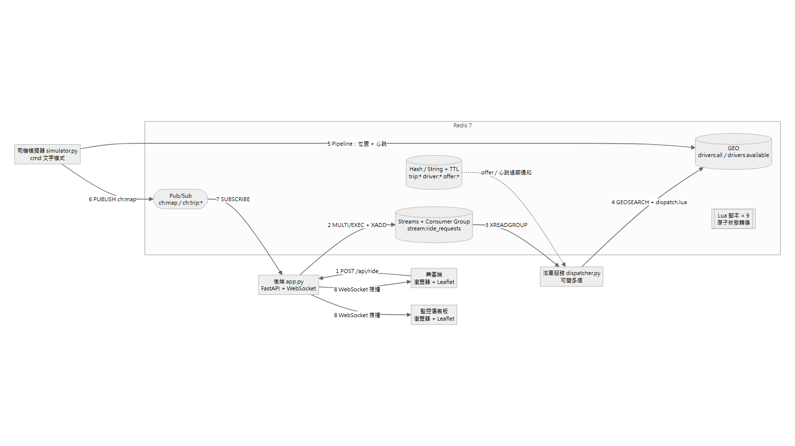

Mermaid 原始碼

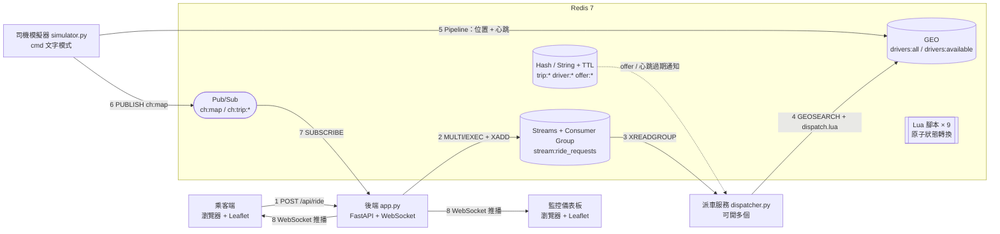

## 用例圖

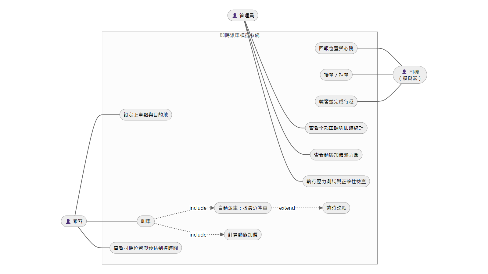

Mermaid 原始碼

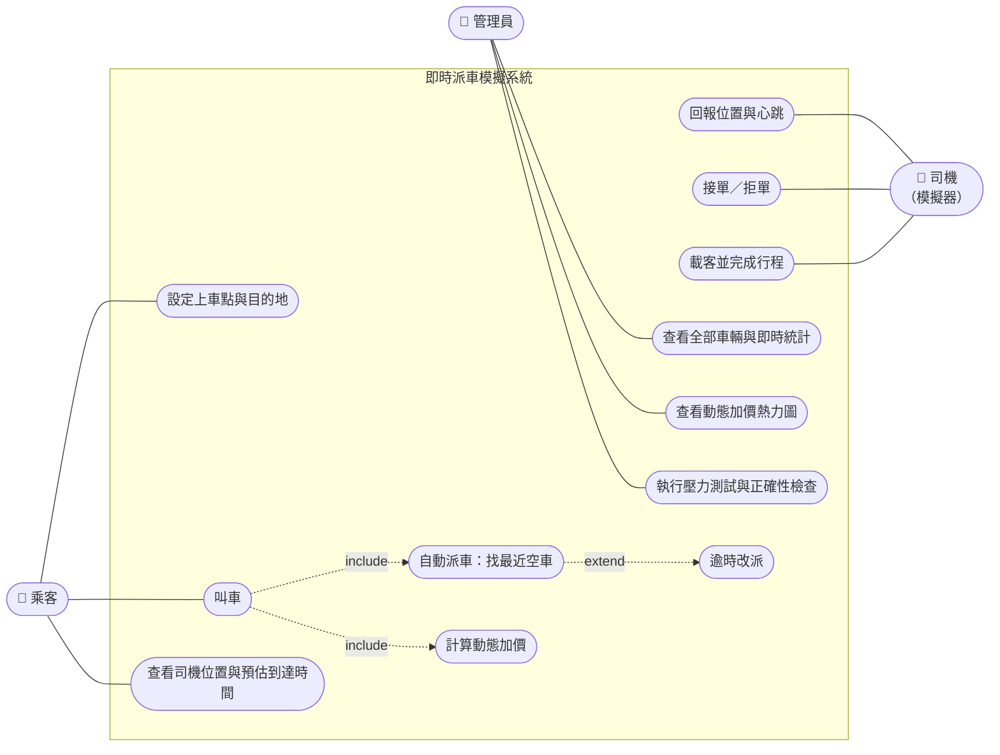

## 循序圖：叫車、派單、逾時改派

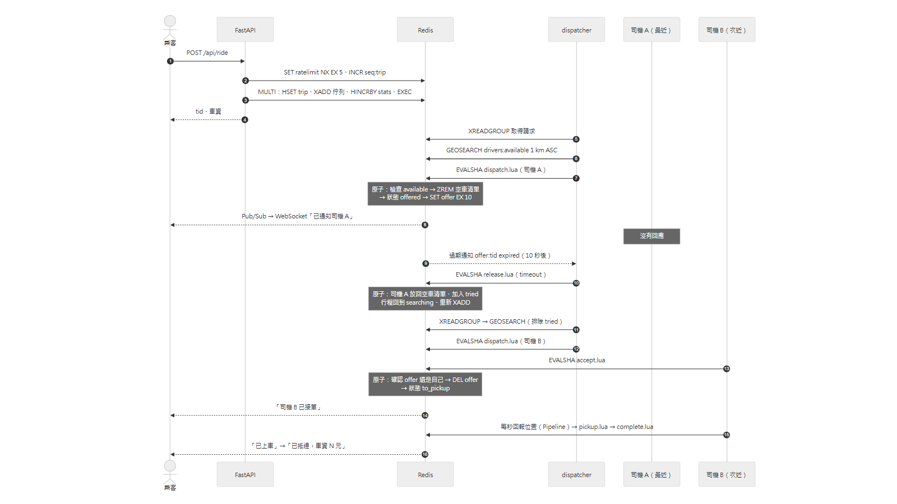

Mermaid 原始碼

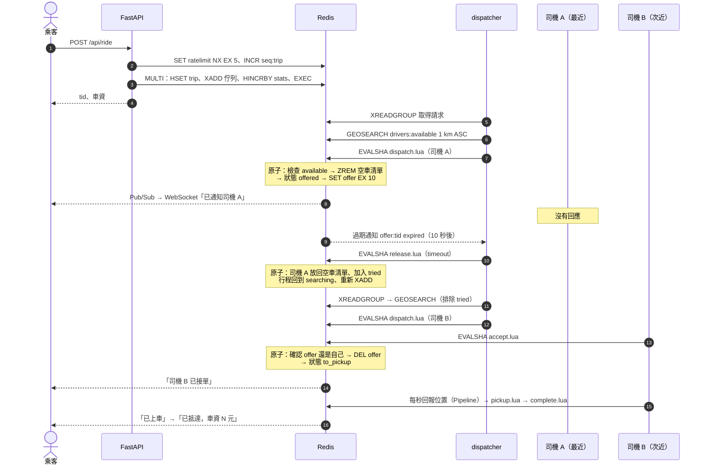

## 狀態圖：司機的五個狀態

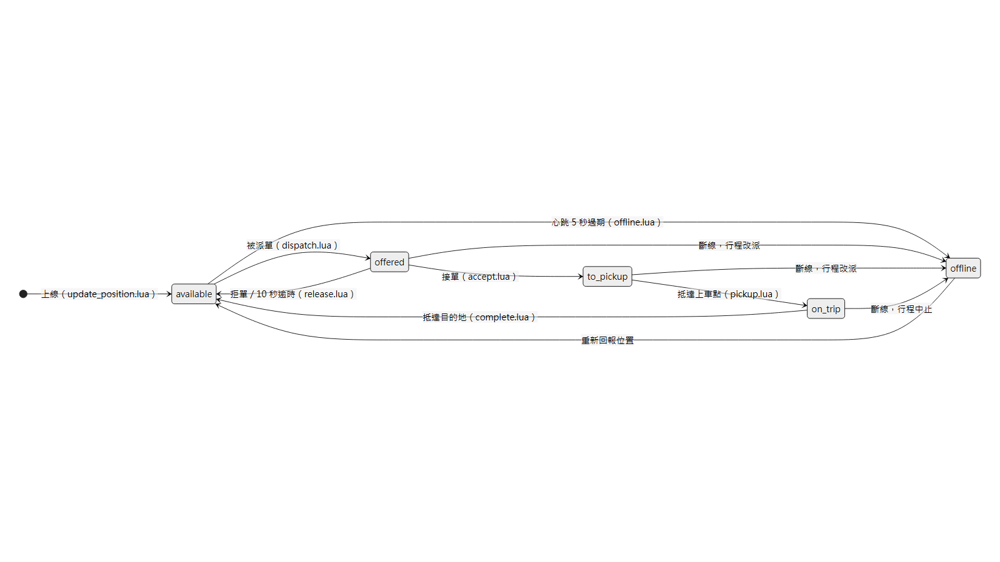

Mermaid 原始碼

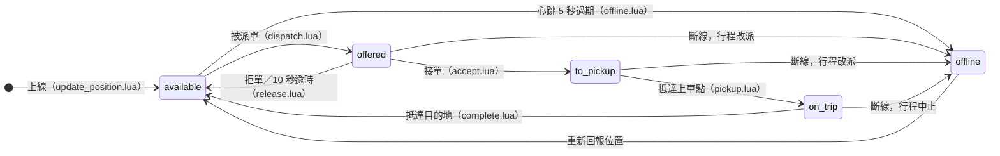

## 活動圖：擴大半徑重試

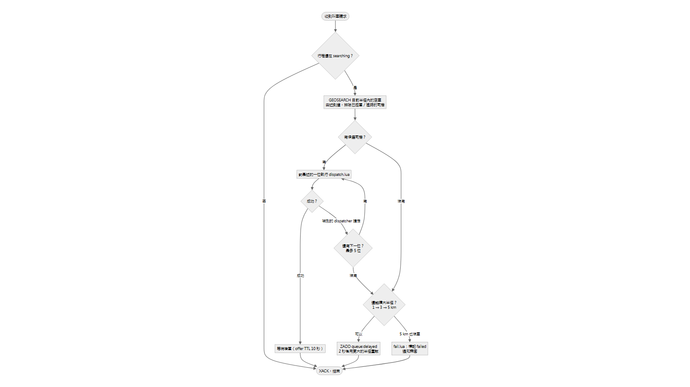

Mermaid 原始碼

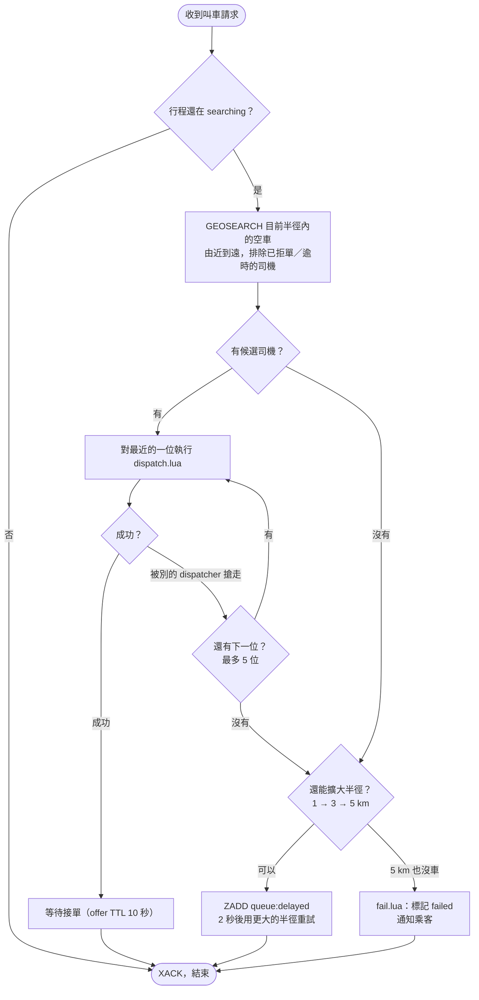

## 部署圖

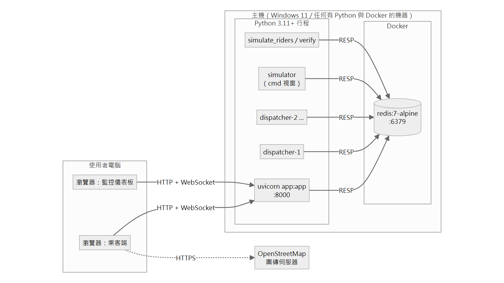

Mermaid 原始碼

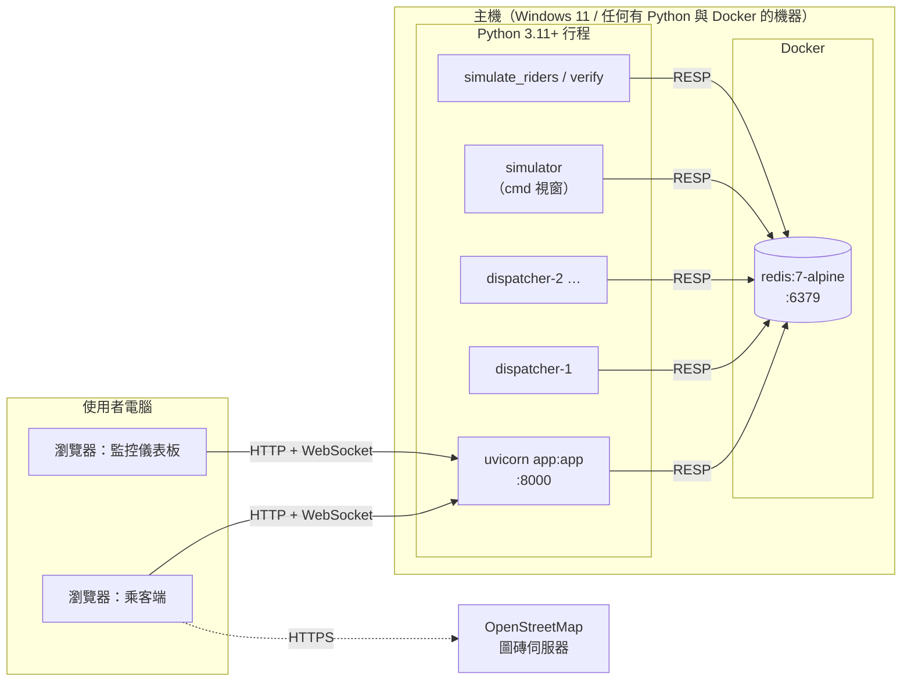

